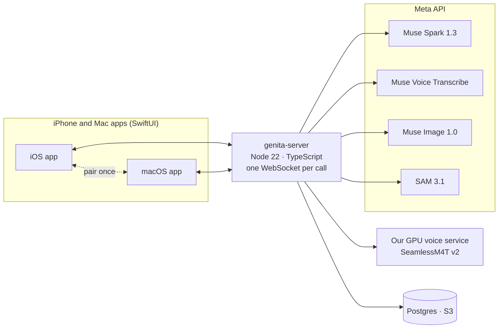

# Genita

### The AI companion that already knows you, sees what you see, and follows you from iPhone to Mac.

Genita is a face-to-face video call with an AI companion. It starts out knowing you from the AI assistant you already use, looks through your camera and your Mac screen with you, answers with cards you can act on, and carries the same conversation from your phone to your laptop.

We built all of it during the Meta Global AI Developer Hackathon on **Muse Spark, Muse Voice Transcribe, Muse Image, SAM 3.1 and SeamlessM4T v2**.

**Track:** Startups · **Topic:** Build for Your World

| Try it | |
| --- | --- |
| 📱 iPhone (TestFlight) | **https://testflight.apple.com/join/Ybqh482p** |
| 💻 Mac (notarized DMG) | **https://bagel-labs-beni.github.io/genita-legal/mac/Genita-latest.dmg** |
| 🔑 Judge access code | **`GENITA-3ANZMN`**: tap **Judge access** on the first screen. No Apple ID or email needed. |
| 🎬 Demo video (3 min) | *link coming* |

---

## Why we built it

People already talk to an AI assistant every day. Three things still break:

1. **Every new AI starts from zero.** You introduce yourself again and again.
2. **It can't see your world.** You describe your fridge, your outfit or your screen in words.
3. **The conversation dies when you switch devices.** Phone to laptop means starting over.

Genita fixes all three in a single call.

## One call with Genita

This is what you will actually see, in order.

| | You | Genita | What's under it |
| --- | --- | --- | --- |
| 1 | Paste one reply from ChatGPT or Claude, or tap **I don't use an AI assistant** and answer three picks | Already knows how you talk, what you like and what you avoid | Muse Spark turns the text into a taste profile. Every call adds to it, so it also learns from plain conversation without any import. |
| 2 | Upload one photo you own: you, your pet or a drawing | It becomes a talking face with the voice and name you pick | Muse Image edits one scene into 5 expressions and 15 mouth shapes. SAM 3.1 rejects any edit where the face drifted. No video model. |
| 3 | Talk. Cut in whenever you want. | Answers out loud, stops the moment you interrupt, captions both sides | Muse Voice Transcribe streams your words. The reply starts before you finish. Each sentence is voiced the moment it is written (SeamlessM4T v2 on our own GPU). |
| 4 | Point the camera and ask **"What's this?"** | Names it, and outlines it on screen | Muse Spark vision, then SAM 3.1 segments the nouns from its own answer on the latest frame. |
| 5 | **"Show me a kimchi fried rice recipe"** · **"Best ramen in Seoul"** · **"How do I fold a fitted sheet?"** · **"Find me a black midi dress"** | Cards with pictures, steps, places on a map, shop links, and **Walk me through it** | Muse Spark web search plus a page reader. A shop link is kept only if the page was really opened. Muse Image fills a missing recipe or how-to picture (never for products or real places). |
| 6 | **"Does this suit me?"** | Gives style feedback using what it already knows about you, and asks lightly when it doesn't know your taste yet | Each reason is tied to a line from your own profile; when nothing overlaps, it gives no made-up reason. |
| 7 | **⋯ → Interpret**, then talk with someone in another language | Translates both ways, follows a switch to another language mid-conversation, and asks once when it can't tell which language you want. The voice speaks English and Korean. | Muse Voice Transcribe + Muse Spark + SeamlessM4T v2, with the pair following whoever is speaking. |
| 8 | **⋮ → Move to Mac** | The same conversation continues on the Mac. Share a YouTube window and watch together. | The server owns the conversation, so two devices never talk at once. The Mac sends frames only when the picture changes, and the video's audio goes to its own transcription session. |

## What we built on top of the Meta models

Calling a model is easy. Making it feel like a person on a video call is the product. Each item below is in this repository.

- **A real-time turn-taking engine.** The reply starts speculatively from your partial transcript. A cut-in counts only after 400 ms of real speech, so "yeah" and echo don't stop the companion. Median time from the end of your sentence to its first sound: **2.7 s** on production logs, of which the voice adds about 0.2 s.
- **A talking face from one photo, with a quality gate.** Every Muse Image edit starts from the same scene so drift never stacks. SAM 3.1 checks each edit and throws it away if the face moved more than 3% or changed size more than 6%. On the device, an optical-flow morph blends mouth shapes on the voice's own timing.
- **Cards that never show a blank tile or a fake link.** Each picture tries the page's own image, then an image search, then a Muse Image illustration where that is honest (ingredients, steps, explainers). If none works, the slot is left out. Generated images are never used for products or real places.
- **Taste you can trace.** "Their simple cuts match the understated style you prefer" points back to something you said. Corrections like "that's not me" rewrite the profile, and the profile shapes the next search.
- **An interpreter that follows the conversation.** It follows a language switch mid-conversation (Korean → Japanese is in our production logs) and asks once in your language when it can't tell.
- **One conversation, two devices.** The server hands the call over with an ownership epoch, closes the iPhone's sound before the Mac may play, and the apps pair once with a six-digit code.
- **Speaks first, politely.** It can open a topic only after 8 s of mutual silence, at least 60 s apart, at most 3 times per call, and stops after two unanswered tries.
- **Guardrails for a companion people talk to every day.** Lines that sound like a counselor or an intake form are dropped before they are voiced. A user who says they are a minor gets no romance. Health, religion, politics, sexuality and finances are never stored in memory.

## Built during the hackathon

**Everything in this repository was built during the hackathon (October 27 to November 5, 2026).** The first commit is from October 31, 2026. No code from our earlier products is used. You can check it yourself:

```sh
git log --reverse --format='%ad %h %s' --date=iso | head
```

Open-source libraries and services we depend on are listed in [Credits](#credits).

## Meta models in Genita

| Model | What it powers |
| --- | --- |
| **Muse Spark 1.3** | Conversation, camera and screen understanding, web search and page reading for cards, profile import, photo check, memory, translation |
| **Muse Voice Transcribe** | Live listening, end of speech, barge-in, interpretation, the audio of a shared video |
| **Muse Image 1.0** | The call scene from one photo, expressions and mouth shapes, recipe and how-to illustrations |
| **SAM 3.1** | Outlines on what the companion names in the camera view, face and mouth checks on every face edit |
| **SeamlessM4T v2** (open model, self-hosted) | The companion's voice in calls and in interpretation |

We also tried Muse Spark Open on Baseten for background jobs; it was not available during our measured window, so those jobs ran on Muse Spark 1.3.



## Try it, step by step

**iPhone**

1. Install Apple's **TestFlight** app from the App Store.
2. On the iPhone, open https://testflight.apple.com/join/Ybqh482p, tap **Accept**, then **Install**.
3. Open Genita, tap **Judge access** and enter `GENITA-3ANZMN`. Or tap **Continue with email** and enter the 6-digit code we send you.
4. Allow the microphone and the camera. The judge account already has a companion, so you can start a call right away.

**Mac**

1. Download https://bagel-labs-beni.github.io/genita-legal/mac/Genita-latest.dmg.
2. Open the DMG and drag **Genita** into **Applications**.
3. Open Genita from Applications. It is notarized by Apple; if macOS asks whether to open an app from the internet, choose **Open**.
4. Click **Judge access** and enter `GENITA-3ANZMN`, or use the same email as on your iPhone.
5. Allow the microphone and the camera. The first time you share a window, macOS asks for **Screen Recording**: turn it on in System Settings, then reopen Genita if asked.
6. To move a call from the iPhone: on the iPhone, open **⋮ → Move to Mac**. The first time, type the six digits the Mac shows.

The Judge access code is rate-limited and is for judging only.

## Run it yourself

Source code, local setup (one Meta API key, no cloud account needed), measured results and known limitations are being added to this repository now and will be complete before judging starts.

## Team

We're Summer and Dyno, a two-person team that has been building together since we met through hackathons in 2020. We're both full-stack builders: between the two of us we designed, coded and shipped every part of Genita, from the iOS and Mac apps to the server, the Meta model pipelines and the cloud deployment. We bring together experience in AI products, product strategy and commercialization.

**Summer (Chaeeun Lee)** · Founder & Product Lead · Full-stack builder · [X: @dearsummer0](https://x.com/dearsummer0)
Founder and CEO of Bagel Labs, the company behind Beni and Genita. Previously Lead Product Manager at Supertone, HYBE's AI audio subsidiary, and Founding Product Owner at Modhaus. Her background spans consumer AI, voice technology, and taking products from early concept to launch, and she writes the code herself, across the apps, the server and the AI pipelines.

**Dyno (Jongwon Park)** · Product & Commercial Strategy · Full-stack builder
A long-time collaborator of Summer and Chief Creative Officer at Bagel Labs. He works on product positioning, brand and commercial strategy, has helped shape Genita's product and growth direction, and builds hands-on across the stack as well.

## Credits

**Meta models.** Muse Spark 1.3, Muse Voice Transcribe, Muse Image 1.0 and SAM 3.1 through the Meta API, under the Meta API terms. SeamlessM4T v2 (Meta AI, FAIR), CC-BY-NC-4.0, self-hosted.

**Open source.** Sparkle (MIT), Three.js (MIT), `pg` and `ws` (MIT), PGlite (Apache-2.0), TypeScript (Apache-2.0), PyTorch and torchaudio (BSD-style), Hugging Face Transformers (Apache-2.0), Pretendard and Noto Serif KR (SIL OFL 1.1). The full list comes with the source.

**Services.** Meta API, Modal, AWS, Resend, Apple (Sign in with Apple, TestFlight, notarization), GitHub Pages.

## License

Our code is licensed under [Apache-2.0](LICENSE). Models, libraries, fonts and services keep their own licenses. Because the voice model is CC-BY-NC-4.0, Genita is a free, non-commercial preview.
