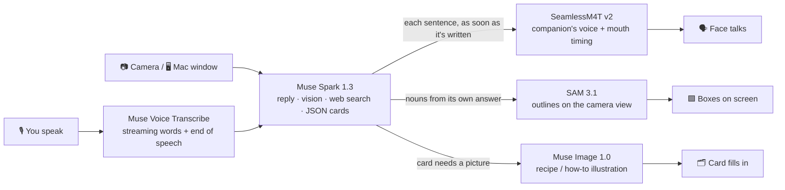

<div align="center">

# Genita

### Easy to start. Personal from the first hello.

**The AI companion that already knows you, sees what you see, and follows you from iPhone to Mac.**

<br/>

[](https://testflight.apple.com/join/Ybqh482p)
[](https://bagel-labs-beni.github.io/genita-legal/mac/Genita-latest.dmg)
[](https://youtu.be/O2b4_xFajqE)

**Judge access code: `GENITA-3ANZMN`** · tap **Judge access** on the first screen, no Apple ID or email needed


**Track:** Startups · **Topic:** Build for Your World

</div>

> **Everything in this demo was built during the hackathon on Meta models; none of our earlier products' code is used.** Genita is a new app, first commit October 31, 2026. The only third-party code is open-source libraries, listed in [Credits](#credits).

## Submission overview

| Criterion | Where to look |
| --- | --- |
| **Eligibility** | Meta Global AI Developer Hackathon · Track: **Startups** · Topic: **Build for Your World**<br>Built from scratch since **October 31, 2026** by Summer and Dyno · public repo, Apache-2.0 · [Built during the hackathon ↓](#built-during-the-hackathon) |
| **Impact** | People already treat an AI assistant as a daily friend, but it lives in a text box, forgets them in every new app and can't see their world. Genita gives that relationship a face, a voice, eyes and continuity across iPhone and Mac, for anyone who can talk and point a camera, no prompt skills needed. Designed from insights already validated with real users of Beni, our separate companion app (33,000 users, 1.3 million messages). [The pitch ↓](#the-pitch) |
| **Use of Meta AI** | **Five Meta models in one call:** Muse Spark 1.3 (reply, vision, web search, JSON cards, taste, memory, translation), Muse Voice Transcribe (streaming, end of speech, barge-in, a second session for shared-video audio), Muse Image 1.0 (a talking face from one photo, card illustrations), SAM 3.1 (outlines from the companion's own words, face-edit quality gate), SeamlessM4T v2 (self-hosted voice and lip timing). [How Genita uses Meta AI ↓](#how-genita-uses-meta-ai) |
| **Technical depth** | Speculative replies from partial transcripts, sentence-by-sentence voice, barge-in that ignores "yeah" and echo, a server-owned conversation that moves between devices without two devices ever talking at once, verified-link cards with a three-step picture fallback. Median **2.7 s** from your last word to the companion's first sound on production logs. Server suite **2,631 tests, 0 failing** at the deployed commit. [What we built on top ↓](#what-we-built-on-top-of-the-models) |
| **Demo** | [3-minute demo video](https://youtu.be/O2b4_xFajqE) · [iPhone via TestFlight](https://testflight.apple.com/join/Ybqh482p) · [Mac DMG](https://bagel-labs-beni.github.io/genita-legal/mac/Genita-latest.dmg) · Judge access code `GENITA-3ANZMN` · [Try it ↓](#try-it-step-by-step) |
| **Who built it** | Two humans directing a fleet of coding agents: **95.6 %** of our commits were co-written by Claude Code. [Who built what ↓](#who-built-what) |

---

## The pitch

For a lot of people, ChatGPT is already a friend. They talk to it every day about what to cook, what to wear and what they're watching. But it lives in a text box, forgets who you are the moment you open a new app, and can't see anything you see.

**Why we built Genita.** Our team also runs Beni, a separate AI companion app with 33,000 users and 1.3 million messages. So Genita isn't a guess: its design comes from insights our users had already validated. Watching people talk to an AI every day showed us what a text chat can't give them. They wanted a companion that already knew them instead of asking the same questions again, one that could see what they were looking at instead of making them describe it, and one that stayed with them when they moved from their phone to their laptop. Genita is the product we started from scratch to answer exactly that: a face and a voice you chose, eyes through your camera and your screen, and one conversation that follows you from iPhone to Mac.

**We are building the most emotive, adaptive companion for daily life.** A face and a voice you chose. A friend who reacts to you, adapts to who you are, and is there on whatever screen you're using.

<table>
<tr>
<td width="33%" valign="top">

### 🧠 It knows you
Bring one reply from the AI you already use. From the first hello, Genita talks like someone who knows your taste, and it keeps learning from every call.

</td>
<td width="33%" valign="top">

### 👀 It sees with you
Point your camera and it names and outlines what it sees. Share your Mac screen and it watches with you. Then it answers with cards you can act on.

</td>
<td width="33%" valign="top">

### 🔁 It follows you
Start on your iPhone, move the call to your Mac from the ⋮ menu. Same companion, same conversation, never two devices talking at once.

</td>
</tr>
</table>

### At a glance

| **5** | **1** | **2.7 s** | **2** | **0** |
| :---: | :---: | :---: | :---: | :---: |
| Meta models working together in one call | photo to make a talking face, no video model | median from your last word to its first word ([how we measured](docs/RESULTS.md)) | devices, one conversation | shop links it didn't actually open |

## Everything Genita does

| | Feature | 📱 iPhone | 💻 Mac |
| --- | --- | :---: | :---: |
| 🧠 | **Starts already knowing you.** Bring one reply from ChatGPT or Claude (you paste text; Genita never calls them), or answer three quick picks. Keeps learning your taste from every call. | ✅ set up | ✅ uses it |
| 🙂 | **A face and a voice from one photo.** You, your pet or a drawing becomes a talking companion with expressions and lip sync. | ✅ set up | ✅ uses it |
| 📞 | **A real video call.** Talk naturally, cut in any time, captions on both sides. | ✅ | ✅ |
| 👀 | **Looks with you.** Point the camera and ask "What's this?" It names things and outlines them on screen. | ✅ front and back camera | ✅ webcam |
| 🗂️ | **Answers you can act on.** Recipes with steps (and "Walk me through it" on iPhone), places with photos and a Maps link, how-to step cards, products with verified shop links, and a real picture whenever there is one. | ✅ | ✅ |
| 👗 | **Style feedback that uses what it knows about you.** It ties each reason to your taste and asks lightly when it doesn't know yet. | ✅ | ✅ |
| 🌏 | **Live interpretation, face to face.** Translates both ways, follows a language switch mid-conversation, asks once when unsure. | ✅ | ✅ |
| 🔁 | **iPhone → Mac, same conversation.** Move the call from **⋮ → Move to Mac**. Pair once with six digits. | ✅ send | ✅ receive |
| 🎬 | **Watch together on the Mac.** Share a YouTube window and talk about it. It follows the story and the video's audio. | | ✅ |
| 💭 | **Remembers and comes back.** Memory across calls, a greeting that picks up where you left off, the same companion on both devices. | ✅ | ✅ |
| 🛡️ | **Safe by default.** No counselor tone, no romance if a user says they're a minor, sensitive topics never stored, daily caps. | ✅ | ✅ |

## One call with Genita

This is what you will actually see, in order.

| | You | Genita | What's under it |
| --- | --- | --- | --- |
| 1 | Paste one reply from ChatGPT or Claude, or tap **I don't use an AI assistant** and answer three picks | Already knows how you talk, what you like and what you avoid | **Muse Spark** turns the text into a taste profile. Every call adds to it, so it also learns from plain conversation without any import. |
| 2 | Upload one photo you own: you, your pet or a drawing | It becomes a talking face with the voice and name you pick | **Muse Image** edits one scene into 5 expressions and 15 mouth shapes. **SAM 3.1** rejects any edit where the face drifted. No video model. |
| 3 | Talk. Cut in whenever you want. | Answers out loud, stops the moment you interrupt, captions both sides | **Muse Voice Transcribe** streams your words. The **Muse Spark** reply starts before you finish. Each sentence is voiced the moment it is written by **SeamlessM4T v2** on our own GPU. |
| 4 | Point the camera and ask **"What's this?"** | Names it and outlines it on screen | **Muse Spark** vision reads the frame, then **SAM 3.1** segments the nouns from its own answer. |
| 5 | **"Show me a kimchi fried rice recipe"** · **"Best ramen in Seoul"** · **"How do I fold a fitted sheet?"** · **"Find me a black midi dress"** | Cards with pictures, steps, places on a map, shop links, and **Walk me through it** | **Muse Spark** web search and page reading fill a structured card. A shop link is kept only if the page was really opened. **Muse Image** fills a missing recipe or how-to picture, never for products or real places. |
| 6 | **"Does this suit me?"** | Style feedback grounded in your taste | Each reason is tied to a line from your profile. When nothing overlaps, it gives no made-up reason. |
| 7 | **⋮ → Interpret a conversation**, then talk with someone in another language | Translates both ways out loud and asks once when it can't tell which language you want | **Muse Voice Transcribe → Muse Spark → SeamlessM4T v2**, with the pair following whoever is speaking. The voice speaks English and Korean. |
| 8 | **⋮ → Move to Mac** | The same conversation continues on the Mac. Share a YouTube window and watch together. | The server owns the conversation, so two devices never talk at once. The Mac sends frames to **Muse Spark** only when the picture changes, and the video's audio goes to its own **Muse Voice Transcribe** session. |

---

## How Genita uses Meta AI

Genita is not one API call wrapped in an app. In a single spoken turn, up to five Meta models run in a pipeline, in parallel, and each one is used for what it is best at.



### Muse Spark 1.3: the brain, in 11 places

Muse Spark runs the conversation and almost every judgment in the product. We use its full surface: streaming, image input, the built-in `web_search` tool, structured output with `json_schema`, and reasoning effort set per job (`minimal` almost everywhere for speed, `low` for the full taste report).

| Where | How we use it |
| --- | --- |
| Live conversation | Streams the reply token by token. We start it **speculatively from your partial transcript** and cut it into sentences so the voice can start before the reply is finished. |
| Camera and screen | Camera frames and the shared Mac window go in as `input_image`, so "what's in my fridge?" and "who's that?" are answered from what you actually see. |
| Cards (recipe, places, how-to, products, answers) | One agent turn: `web_search` → open pages → a JSON card we validate before it reaches the app. We keep a product link **only if the tool trace shows the page was opened**. |
| Taste profile | Turns a pasted reply from your own AI assistant into a style card; merges what you say in every call; rewrites it when you say "that's not me". |
| Style feedback | Ties each reason to the closest line of your own profile, so it never invents a taste. |
| Photo check, companion card, name | Checks the uploaded photo, writes the companion card, suggests a name. |
| Memory and comeback | Extracts memories after a call and picks up where you left off. |
| Interpretation | Translates each line and asks once, in your language, when the target language is unclear. |
| Watch together | Keeps a running story memo of the video you share, so questions about the scene make sense. |
| Speaking first | Short reads from the camera decide whether to open a topic, within strict limits (below). |
| Guardrails | Lines that read like a counselor or an intake form are dropped before they are voiced. |

### Muse Voice Transcribe: the ears

- **Realtime WebSocket streaming** of microphone audio, with partial and final transcripts and **end-of-speech detection**.
- Partials drive the speculative reply; end of speech commits the turn.
- **Barge-in:** a cut-in counts only after 400 ms of real speech or enough words, so "yeah" and echo don't stop the companion.
- **A second session with speaker separation** listens to the audio of the video you share on the Mac.
- In interpretation it decides who is talking by language.

### Muse Image 1.0: the face, and pictures for cards

- **Generations and edits.** One uploaded photo → one call scene → up to 20 edits from that same scene: 5 expressions (blink, smile, warm, surprised, concerned), 10 viseme mouth shapes and 5 conversational mouth keys.
- Every edit starts from the same scene, so drift never stacks. The device blends the stills with an optical-flow morph on the voice's timing. **A talking face with no video model.**
- Illustrations for recipe ingredients, steps and how-to cards when the web has no usable picture. Never used for products or real places, so you never see a fake product photo.

### SAM 3.1: the eyes that point

- **Text-prompted segmentation with the companion's own words.** After a camera answer, the nouns it said go to SAM 3.1 on the latest frame and come back as boxes (and soft pixel masks), drawn live and faded when the phone moves.
- **A quality gate for the face.** On every Muse Image edit, SAM 3.1 finds the face and the mouth; an edit is rejected if the face moved more than 3% of the width, changed size more than 6%, or has no mouth.
- We ported the decoder from Meta's `@meta-sam/parser` to read SAM's mask format in our server.

### SeamlessM4T v2: the voice (Meta open model, self-hosted)

- Hosted by us on our own GPU container, **streaming 24 kHz audio per sentence**, 4 voices we picked from its 200 speakers, English and Korean.
- Its own per-character durations drive the lip sync, so the mouth needs no extra model.
- Measured: the voice adds about **0.2 s** to a turn; the rest of the wait is the model thinking.

We also wired Muse Spark Open on Baseten for background jobs; it was not available during our measured window, so those jobs ran on Muse Spark 1.3.

---

## What we built on top of the models

**A model gives you an answer. A companion needs timing, a face, memory, eyes and manners.** Almost all of our ten days went into that layer: the experience engineering between the Meta models and the person on the call. Every row below is code in this repository, and the numbers come from production logs or evals against the real Muse Spark.

| The experience | A raw model call gives you | What we engineered | Measured |
| --- | --- | --- | --- |
| **Talks like a call, not a chatbot** | A full reply after you finish, read out at the end | Speculative replies from the partial transcript, each sentence voiced the moment it is written, barge-in that only counts 400 ms of real speech so "yeah" and echo don't cut it off | **2.7 s** median from your last word to its first sound; the voice adds about **0.2 s** |
| **Answers what you just said** | Replies that drift to whatever is in the profile, invented openers | A conversation prompt we rebuilt and bake-off tested: the first sentence answers your last line; no unprompted topics, times or meals; no fake "you're back" lines; a guard on repeated greetings | Off-topic replies **15 → 7** per 94 turns, invented openers **2 → 0**, repeated greetings **21 → 2** per ~600 turns |
| **A face from one photo** | One image | 20 Muse Image edits from the same scene (expressions, visemes, mouth keys), a SAM 3.1 gate that rejects any edit where the face moved > 3 % or resized > 6 %, an optical-flow mouth driven by the voice's own timing | A person, a pet or a drawing talks, with no video model |
| **Knows you, and keeps learning** | A text box that forgets you | Import from the AI you already use, plus taste learned from plain conversation; corrections rewrite the profile; every style reason is tied to a line you actually said, and it asks once, lightly, when it doesn't know | Taste quoted in **6/6** style calls; No-AI users asked once and the learned fact used **6/6** |
| **Answers you can act on, and trust** | Text with links that may not exist | Cards built from web search and page reading; a shop link survives only if the page was really opened; pictures fall back from the page, to image search, to a Muse Image illustration (never for products or real places), else the slot is left out | Product names invented before the card: **0/16** |
| **Sees with you** | A description of an image | The nouns of its own answer go to SAM 3.1 on the latest frame and come back as outlines that fade when the phone moves | Outlines on what it names, in the same turn |
| **Interprets face to face** | Translation of one line | Speaker by language, a correction pass that never delays the line, follows a mid-conversation language switch, asks once when unsure | First translated text **1.29 s** (KO→EN) / **1.46 s** (KO→JA) median; switch followed **8/8** |
| **One conversation, two devices** | Two separate sessions | Server-owned conversation with an ownership epoch; the iPhone's sound closes before the Mac may play; pair once with six digits | Never two devices talking at once |
| **Watches a video with you** | Screenshots on request | Mac window share that sends frames only when the picture changes, the video's audio on its own diarized transcription, a running story memo, quiet restart if macOS interrupts the capture, a gate so the video's voices aren't taken as yours | "Who's that?" answered about the scene |
| **Friendly, not needy** | Talks whenever prompted | Speaks first only after 8 s of mutual silence, at least 60 s apart, at most 3 times per call, stops after two unanswered tries | |
| **Safe by default** | Whatever the model says | Drops counselor-like or intake-form lines before they are voiced, no romance if a user says they are a minor, never stores health, religion, politics, sexuality or finances, daily caps per account | |

## Built during the hackathon

**Everything we wrote in this repository was built during the hackathon (October 27 to November 5, 2026, KST). The first commit is dated October 31, 2026 (KST). No code from our earlier products is used; open-source dependencies are listed in [Credits](#credits).**

| # | Feature | What we built | First commit (KST) |
| --- | --- | --- | --- |
| F1 | Sign-in and consent | Email-code and Sign in with Apple accounts, consent, account deletion, Judge access with rate limits | Nov 2 |
| F2 | Start already knowing you | The import prompt, parsing, and a taste card that keeps learning from calls | Nov 1 (prompt), Nov 2 (server) |
| F3 | Face, voice and name from one photo | Photo check, Muse Image scene, expressions and mouth shapes, SAM 3.1 drift checks, voices, name | Nov 2 |
| F4 | Companion setup | Setup questions that shape how the companion talks, and the companion card | Nov 2 |
| F5 | Video call | Realtime loop, speculative replies, barge-in, the mouth engine, the expression renderer, speak-first rules, guardrails | Nov 2 (core), Nov 3 (conversation engine) |
| F6 | Look together with the camera | Camera questions, SAM 3.1 boxes and masks | Nov 3 |
| F7 | Cards and Finds | Recipe, place, how-to, product and answer cards with real links and pictures | Nov 2 |
| F8 | iPhone → Mac move | Conversation ownership, pairing, proximity, screen registration, the move effect | Nov 1 |
| F9 | Mac call and watching together | Mac call client, window share, running story memo | Oct 31 (Mac app), Nov 2 (watch) |
| F10 | Live interpretation | Transcribe → Spark translation → voice, language picked automatically | Nov 2 |
| F11 | Memory | Memory extraction, storage, recall, forgetting during a call | Nov 2 |
| F12 | Coming back | Return greeting, same companion and context on both devices | Nov 2 |

**About Beni.** Our team also runs Beni, a separate companion app; the demo video mentions its user numbers as background, because that is where we learned what people want from a companion. Genita shares no code or product assets with Beni; only company accounts (our domain, Apple developer account and YouTube channel) are shared. Everything listed above was written from scratch for this hackathon.

**About the move effect.** The iPhone → Mac transition uses EffectSource, an open-source blur shader and sampler (MIT, © 2026 Akash T, license kept next to the source in `shared/Handoff/EffectSource/`; the upstream code is `wipe-source.txt`). That shader is a dependency, not our work; the other files in that folder, the compositor around it and everything else in the handoff are new code.

Some early commits have voice and image adapters for non-Meta providers. We replaced them during the hackathon to follow the Meta-only rule; every AI model the latest commit calls is a Meta model. One iOS system feature is not: the "What's off?" correction field can use Apple's on-device dictation (`SFSpeechRecognizer`).

**Verify it yourself** (once the source is pushed, see below):

```sh
git log --reverse --date=iso --format='%ad  %an  %s' | head -5     # first commits: Oct 31, 2026
git log --no-merges --date=short --format='%ad' | sort | uniq -c   # commits per day
```

---

## Try it, step by step

**iPhone**

1. Install Apple's **TestFlight** app from the App Store.
2. On the iPhone, open https://testflight.apple.com/join/Ybqh482p, tap **Accept**, then **Install**.
3. Open Genita, tap **Judge access** and enter `GENITA-3ANZMN`. Or tap **Continue with email** and enter the 6-digit code we send you.
4. Accept the consent screen and allow the microphone and the camera. The judge account already has a companion, so you can start a call right away.

**Mac**

1. Download https://bagel-labs-beni.github.io/genita-legal/mac/Genita-latest.dmg.
2. Open the DMG and drag **Genita** into **Applications**.
3. Open Genita from Applications. It is notarized by Apple; if macOS asks whether to open an app from the internet, choose **Open**.
4. Click **Judge access** and enter `GENITA-3ANZMN`, or use the same email as on your iPhone.
5. Allow the microphone and the camera. The first time you share a window, macOS asks for **Screen Recording**: turn it on in System Settings, then reopen Genita if asked.
6. **Move a call from the iPhone:** keep the Mac app open and signed in to the same account, with both devices nearby on the same Wi-Fi. On the iPhone, open **⋮ → Move to Mac** and allow **Local Network** when asked. The first time, type the six digits the Mac shows.
7. **Watch together:** in a Mac call, share a YouTube window and ask about what's playing.

The Judge access code is rate-limited and is for judging only.

## Source code and docs

The full source is in this repository: the iOS and Mac apps (SwiftUI) in `ios-app/`, `mac-app/` and `shared/`, the Node/TypeScript server in `genita-server/`, the GPU voice service in `deploy/modal-voice/`, and the AWS deployment in `deploy/aws/`.

| Doc | What's in it |
| --- | --- |
| [Technical deep dive](docs/TECHNICAL.md) | Every Meta model call, the layer we built on top, and the architecture |
| [Run it yourself](docs/RUN_LOCALLY.md) | Local server with one Meta API key; the companion's voice needs the GPU service in `deploy/modal-voice/` |
| [Measured results and limitations](docs/RESULTS.md) | Latency from production logs, card times, known limits |
| [Built during the hackathon](docs/BUILT_DURING_HACKATHON.md) | Feature-by-feature first commits and how to verify them |
| [Credits](docs/CREDITS.md) · [NOTICE](NOTICE.md) · [Third-party notices](THIRD_PARTY_NOTICES.md) | Every model, library, font and service with its license |

## Who built what

**We are a fully AI-native team: two humans directing a fleet of coding agents.** Summer and Dyno set the product, the design and every decision; AI coding agents wrote most of the code, in parallel lanes, each with its own branch, tests and review.

| Who | Role |
| --- | --- |
| **Summer** (human) | Product, conversation design, direction and review of every lane, release decisions, device QA |
| **Dyno** (human) | Design prototype and first app commits, product and brand direction |
| **Claude Code** (Anthropic) | Lead implementation agent: ran parallel lanes for the server, the iOS and Mac apps, QA (simulator, iPhone Mirroring, Mac), evals against real Muse Spark, deployment and this repository |
| **Codex** (OpenAI) | Pair implementation on some lanes and an independent cross-review before merges |

**Commit audit.** In our working history, **1,854 of 1,940** non-merge commits (**95.6 %**) carried a Claude Code co-author line and **74** (**3.8 %**) a Codex one. We removed those lines from this public history so the repository's contributor list shows only the registered team members; the commits and their dates are otherwise unchanged.

The agents are development tools only. At runtime Genita calls Meta models alone.

> P.S. Yes, we know. English isn't our first language, and nobody told us how close "Genita" is to another English word until it was too late to rename. On the bright side, you won't forget it.

## Team

We're Summer and Dyno, a two-person team that has been building together since we met through hackathons in 2020. We're both full-stack builders: between the two of us we designed, coded and shipped every part of Genita, from the iOS and Mac apps to the server, the Meta model pipelines and the cloud deployment. We bring together experience in AI products, product strategy and commercialization. Our team also runs Beni, a separate companion app used by 33,000 people; that is where we learned what people want from a companion, and Genita is the new product we built from scratch for this hackathon.

**Summer (Chaeeun Lee)** · Founder & Product Lead · Full-stack builder · [X: @dearsummer0](https://x.com/dearsummer0)
Founder and CEO of Bagel Labs, the company behind Beni and Genita. Previously Lead Product Manager at Supertone, HYBE's AI audio subsidiary, and Founding Product Owner at Modhaus. Her background spans consumer AI, voice technology, and taking products from early concept to launch, and she writes the code herself, across the apps, the server and the AI pipelines.

**Dyno (Jongwon Park)** · Product & Commercial Strategy · Full-stack builder
A long-time collaborator of Summer and Chief Creative Officer at Bagel Labs. He works on product positioning, brand and commercial strategy, has helped shape Genita's product and growth direction, and builds hands-on across the stack as well.

## Credits

**Meta models.** Muse Spark 1.3, Muse Voice Transcribe, Muse Image 1.0 and SAM 3.1 through the Meta API, under the Meta API terms. SeamlessM4T v2 (Meta AI, FAIR), CC-BY-NC-4.0, self-hosted.

**Open source.** EffectSource's blur shader and sampler (MIT, © 2026 Akash T), the base of the move effect, with our compositor on top; Sparkle, Three.js, esbuild, `pg`, `ws` (MIT); PGlite, TypeScript, Hugging Face Transformers (Apache-2.0); PyTorch and torchaudio (BSD-style); the CMU Pronouncing Dictionary; OpenCV, NumPy and SciPy (face preparation); fonts under their own licenses. The full list is in [THIRD_PARTY_NOTICES.md](THIRD_PARTY_NOTICES.md).

**Services.** Meta API, Modal, Baseten, AWS, Resend, Apple (Sign in with Apple, TestFlight, notarization), GitHub Pages.

## License

Our code is licensed under [Apache-2.0](LICENSE). Models, libraries, fonts and services keep their own licenses. Because the voice model is CC-BY-NC-4.0, Genita is a free, non-commercial preview.
