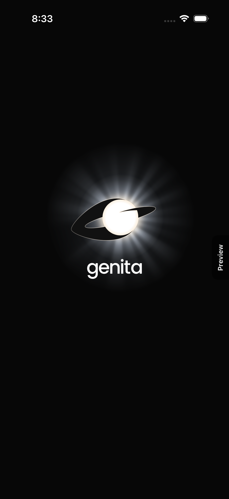
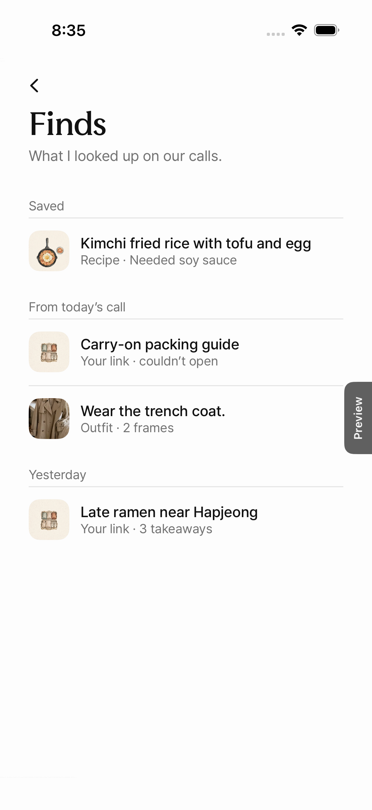
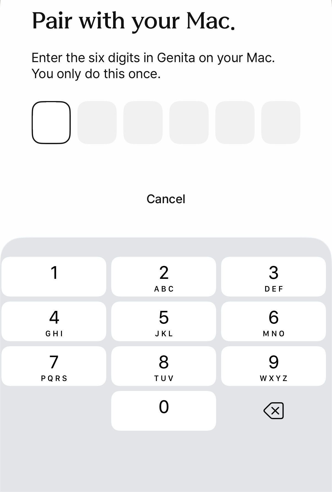

# Results and limitations

Part of the [Genita README](../README.md).

### Measured (real model output, production server)

Source: production server logs of three windows on November 4, 2026, 22:04 to 00:32 KST (13:04 to 15:32 UTC), on that evening's deployments up to `deploy/demo-0035`. Real calls on an iPhone, real Meta models, voice on our GPU. The samples are small; the numbers are what the log fields say.

| What | Log field | n | Result |
| --- | --- | --- | --- |
| End of your speech → first sound of the reply (voice turns) | `turn.answered.speechEndToFirstAudioMs` | 23 | p50 **2.73 s**, p90 **4.31 s**, min 2.11 s, max 7.95 s; 14 of 23 under 3 s |
| Of that: reply start → first Muse Spark token | `replyStartToFirstTokenMs` | 24 | p50 2.28 s, p90 3.27 s |
| Of that: first sentence → first voice audio (voice service) | `firstSentenceToFirstAudioMs` | 24 | p50 0.17 s, p90 0.39 s |
| Recipe card ready | `find.done.cardMs` (kind `recipe`) | 2 | 7.2 s, 8.6 s; pictures at 11.4 s, 13.9 s |
| Product card ready (2 products kept, 3 pages opened) | `find.done.cardMs` (kind `product`) | 1 | 12.5 s; pictures at 15.9 s |
| Answer card ready (web search) | `find.done.cardMs` (kind `answer`) | 5 | 7.6 to 14.8 s (7.6, 10.1, 10.1, 14.3, 14.8) |
| "What's this?" with the camera | `find.done.doneMs` (kind `identify`) | 2 | 2.7 s, 4.2 s |
| Interpretation: end of speech → first translated sound | `interpret.relayed.ms` | 3 | 1.28 s (EN→KO), 1.46 s (KO→EN), 3.30 s (KO→JA) |

Card times run from the start of the card job, beside the spoken answer, which plays first.

**Tests.** Server suite at the deployed commit: `npm test` in `genita-server/` gives 2592 tests, 2581 passed, 0 failed, 11 skipped. The Swift package tests and app UI tests run in CI (`.github/workflows/apple-build.yml`).

### Sample and fixture data (not live model output)

- The screenshots above are UI-test captures with bundled sample data. The "Preview" tab on the right edge marks them.
- `genita-server/evals/import/samples/` are synthetic import replies. `genita-server/evals/convo/fixtures/` are fixed transcripts for offline checks.
- `shared/protocol-samples/` holds hand-written protocol messages.

### Known limitations

- **Latency is borderline.** The median voice turn takes 2.7 s from end of speech to first sound, and 1 in 10 takes over 4.3 s. Most of it is waiting for the first Muse Spark token; the voice adds about 0.2 s.
- **Audio upload stalls.** In the same windows, Muse Voice Transcribe sometimes closed with "Ingress audio slower than real-time" (8 times), when the phone's audio upload fell behind.
- **Mac screen share can be interrupted.** macOS can stop a ScreenCaptureKit stream on its own; when that happens, start the share again.
- **Voice quality.** SeamlessM4T v2 is a translation model with speech output, not a voice-acting model. Some voices sound flat or mechanical. On some Macs the voice can sound robotic through the call's echo cancellation; a split audio path exists behind a switch, off by default.
- **No voice without the GPU.** If the voice service is down, the companion's lines appear as captions only.
- **Product results are not verified by us.** Product links are kept only when Muse Spark actually opened the page in its tool trace. Price and stock are shown only when seen on the page, and can change. We do not check product quality or availability.
- **Muse Spark Open** was not available on Baseten during the measured window; those jobs ran on Muse Spark 1.3.
- **Non-commercial preview.** SeamlessM4T v2 and MMS are licensed CC-BY-NC-4.0, so Genita is a free, non-commercial preview. No fee is charged.
- The apps and the conversation are in English. Interpretation also covers Korean and other languages Muse Voice Transcribe recognizes.

## Screenshots

UI-test captures with bundled sample data (the "Preview" tab on the right edge marks them), not live model output.

  
