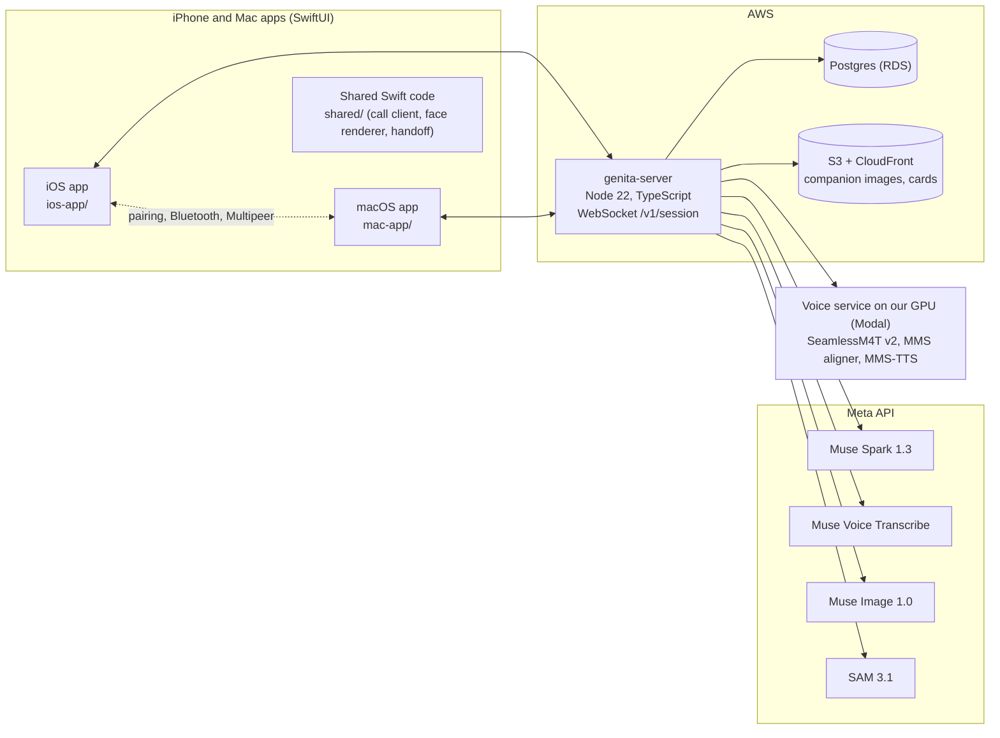

# How Genita uses the Meta models

Part of the [Genita README](../README.md).

## Meta AI integration

Every AI model Genita calls at runtime is a Meta model, with one on-device exception: on the iPhone, the "hold to say" field for editing your profile card uses Apple's on-device dictation (`SFSpeechRecognizer`). Paths are relative to this repository.

| Model (exact name) | Where it runs | Feature it powers | Input → processing → output | Why this model | Implementation |
| --- | --- | --- | --- | --- | --- |
| **Muse Spark 1.3** (`muse-spark-1.3`) | Meta API, `POST /v1/responses` (streaming) | Conversation replies; camera and screen understanding; web search and page reading for recipes, products and answers; profile import; photo check; persona card; name suggestion; memory; translation; expression reads for "speak first" | Transcript, camera or shared-window frames (`input_image`), profile and memory → reasoning effort `minimal`/`low`, tool `web_search`, structured output with `json_schema` → streamed reply text, tool trace, JSON cards | One model covers vision, tools, structured output and streaming, so one agent can look, search and answer in the same turn | [`meta/spark.ts`](../genita-server/src/meta/spark.ts), [`session/session.ts`](../genita-server/src/session/session.ts), [`finds/pipeline.ts`](../genita-server/src/finds/pipeline.ts), [`finds/product.ts`](../genita-server/src/finds/product.ts), [`prep/importProfile.ts`](../genita-server/src/prep/importProfile.ts), [`prep/classify.ts`](../genita-server/src/prep/classify.ts), [`prep/personaCard.ts`](../genita-server/src/prep/personaCard.ts), [`prep/naming.ts`](../genita-server/src/prep/naming.ts), [`perception/controller.ts`](../genita-server/src/perception/controller.ts), [`interpret/interpreter.ts`](../genita-server/src/interpret/interpreter.ts), [`watch/watch.ts`](../genita-server/src/watch/watch.ts) |
| **Muse Voice Transcribe** (`muse-voice-transcribe-1.0`) | Meta API, realtime WebSocket `wss://api.meta.ai/v1/asr/realtime` | Live listening, end of speech, barge-in, interpretation; a second session with speaker separation for the audio of a shared video | Microphone PCM (or shared-window audio) → streaming recognition → partial and final transcripts with end of speech | Realtime streaming with end-of-speech detection is what turn-taking and barge-in need | [`meta/transcribe.ts`](../genita-server/src/meta/transcribe.ts), [`session/turnMachine.ts`](../genita-server/src/session/turnMachine.ts), [`interpret/asrCorrect.ts`](../genita-server/src/interpret/asrCorrect.ts), [`watch/watch.ts`](../genita-server/src/watch/watch.ts) |
| **Muse Image 1.0** (`muse-image-1.0`), generations and **edits** | Meta API, `/images/generations` and `/images/edits` | The call scene from one photo; 5 expressions (blink, smile, warm, surprised, concerned), 10 viseme mouth shapes and 5 conversational mouth keys, each edited from the same scene; illustrations for recipe and how-to cards | One uploaded photo → scene edit → up to 20 edits from that scene → stills stored per companion; card text → illustration (never for products or real places) | Edits keep the same person, animal or character across every shape, so a talking face comes from still images instead of a video model | [`meta/media.ts`](../genita-server/src/meta/media.ts), [`prep/pipeline.ts`](../genita-server/src/prep/pipeline.ts), [`prep/face.ts`](../genita-server/src/prep/face.ts), [`finds/imageGen.ts`](../genita-server/src/finds/imageGen.ts) |
| **SAM 3.1** (`sam-3.1`) | Meta API | Boxes on what the companion names in the camera view; head box for the photo check; face and mouth boxes on every face edit | Camera frame + nouns from the reply, or a face edit + "face"/"mouth" prompts → segmentation → boxes (and pixel masks) | Text-prompted segmentation turns the reply's own words into boxes, and gives a check for each face edit | [`meta/sam.ts`](../genita-server/src/meta/sam.ts), [`meta/samMask.ts`](../genita-server/src/meta/samMask.ts), [`observe/boxes.ts`](../genita-server/src/observe/boxes.ts), [`prep/face.ts`](../genita-server/src/prep/face.ts), [`prep/classify.ts`](../genita-server/src/prep/classify.ts) |
| **SeamlessM4T v2** (`facebook/seamless-m4t-v2-large`), Meta open model | Self-hosted on our own GPU container on Modal | The companion's voice (English and Korean), in calls, voice previews and interpretation | Reply sentence → text-to-speech, 200 speakers → streamed 24 kHz PCM with per-character timing | A Meta open model we can host ourselves for streaming speech; its own character durations time the mouth without another model | [`deploy/modal-voice/voice_app.py`](../deploy/modal-voice/voice_app.py), [`tts/seamless.ts`](../genita-server/src/tts/seamless.ts) |
| **MMS forced aligner** (torchaudio `MMS_FA`), Meta open model | Same GPU container | Optional word and phoneme timing for the mouth (`GENITA_VOICE_ALIGN=1`, off by default) | Synthesized audio + text → forced alignment → word and phoneme times, sent after the audio so the first sound never waits | Phoneme-level timing from the same Meta model family | [`deploy/modal-voice/align.py`](../deploy/modal-voice/align.py) |
| **MMS-TTS** (`facebook/mms-tts-eng`, `facebook/mms-tts-kor`), Meta open model | Same GPU container | Backup voice, selected with `GENITA_VOICE_MODEL=mms` | Text → speech | A second Meta voice on the same service | [`deploy/modal-voice/voice_app.py`](../deploy/modal-voice/voice_app.py) |

Notes:

- **Muse Spark Open was tried, not used.** The server can send background JSON jobs (memory extraction, call summaries, profile writing) to Muse Spark Open (`meta-models/muse-spark-open-1026`) on Baseten, but in the production logs we measured Baseten never listed the model (`llm.spark_open status:"not_listed"`, HTTP 404), so every one of those jobs ran on Muse Spark 1.3. We do not count it as a model we use. Local mode does not contact Baseten.
- **On the device.** App code draws the face from the Muse Image stills: [`FaceRenderer.swift`](../shared/GenitaKit/Sources/GenitaKit/Face/FaceRenderer.swift), [`FlowMorph.swift`](../shared/GenitaKit/Sources/GenitaKit/Face/FlowMorph.swift) (optical-flow blend between mouth shapes), [`LipTimeline.swift`](../shared/GenitaKit/Sources/GenitaKit/Lips/LipTimeline.swift). This is rule code, not a model.
- **Operating-system features, not AI model calls:** Sign in with Apple; ARKit and Apple Vision rectangle detection (finding the Mac screen for the move); Multipeer Connectivity and Core Bluetooth (devices nearby); ScreenCaptureKit (Mac window share); Apple's on-device dictation (`SFSpeechRecognizer`) in the hold-to-speak field when you correct a profile card. The apps never speak with the system voice: the companion is heard only in its server voice.
- **Development tools are not runtime.** We used AI coding assistants while writing code. Genita does not call them, or ChatGPT, Claude or any non-Meta AI, at runtime. The profile you import is text you chose to copy from your own assistant.

## What we built on top of the Meta models

The models give us understanding, speech and images. The product is the layer around them. Each row below is in the code at the submitted commits.

| Capability | Meta model used | What we added | Why it matters |
| --- | --- | --- | --- |
| **Real-time call loop** | Muse Voice Transcribe, Muse Spark 1.3, SeamlessM4T v2 | A pure turn-taking reducer ([`session/turnMachine.ts`](../genita-server/src/session/turnMachine.ts)). A reply starts speculatively from the partial transcript before you finish (`speculative: hit` on most measured turns). Each finished sentence goes to the voice at once. Barge-in cancels only after 400 ms of real speech or enough words, so "yeah" and echo do not cut the companion off. The server then stops the voice stream. | Talking feels like a call, not walkie-talkie turns. The voice adds about 0.2 s; the rest of the wait is the model. |
| **A face from one photo** | Muse Image 1.0 edits, SAM 3.1, Muse Spark 1.3 | Photo check (type, quality, head box in parallel). Every edit starts from the same scene, so drift never stacks. SAM 3.1 rejects an edit when the face moved more than 3% of the width, its size changed more than 6%, or no mouth is found, with one retry ([`prep/face.ts`](../genita-server/src/prep/face.ts)). On the device, an optical-flow morph blends the mouth shapes on the voice's timing. | A person, a pet or a drawn character becomes a talking companion with no video model and no recording session. |
| **Taste that learns and feeds search** | Muse Spark 1.3 | The imported reply becomes a style card. After each call, explicit statements and repeated patterns are merged in; "That's not me" corrections rewrite the card ([`personalize/service.ts`](../genita-server/src/personalize/service.ts)). Product search ties each reason to the closest of your own taste lines and shows no taste reason when none of your lines overlaps ([`finds/product.ts`](../genita-server/src/finds/product.ts) `groundStyle`). | "Their simple cuts match the understated style you prefer" is traceable to something you said, not made up. |
| **Cards with real links and no empty pictures** | Muse Spark 1.3 (`web_search`), Muse Image 1.0 | A product URL is kept only if the tool trace shows the page was opened. Each card picture tries the page's own picture, then a web search for a picture, then (only for ingredients, recipe and how-to steps, and explainer cards) a Muse Image illustration; otherwise the slot is left out instead of showing an empty box ([`finds/imageGen.ts`](../genita-server/src/finds/imageGen.ts), [`finds/imageFinder.ts`](../genita-server/src/finds/imageFinder.ts)). Generated pictures are never used for products or real places. | The sheet never shows a broken link or a blank tile, and never shows a fake product photo. |
| **Camera labels and outlines** | Muse Spark 1.3, SAM 3.1 | When a turn carried camera frames and asks about what it sees, the nouns of the reply go to SAM 3.1 on the latest frame, in the background after the reply ([`observe/boxes.ts`](../genita-server/src/observe/boxes.ts)). The app draws boxes, or soft pixel masks when `GENITA_SAM_MASKS=1`, and fades them when the phone moves ([`shared/Call/CameraBoxes.swift`](../shared/Call/CameraBoxes.swift)). | You can see what the answer is based on. |
| **Free-language live interpretation** | Muse Voice Transcribe, Muse Spark 1.3, SeamlessM4T v2 | Who is talking is decided by language. With the free-language switch on (`GENITA_INTERPRET_FREE_LANG`), the pair follows the other person's language; when Genita cannot tell which language to translate into, it asks once, in your language: "Which language should I translate into?" ([`interpret/interpreter.ts`](../genita-server/src/interpret/interpreter.ts), [`interpret/language.ts`](../genita-server/src/interpret/language.ts)). A short correction pass fixes likely recognition slips. | Face-to-face help with someone who does not speak your language. The measured log includes a switch from Korean→English to Korean→Japanese. |
| **iPhone → Mac call move** | none (our code) | The server owns who has the conversation (`active_device` + epoch). A move closes the old device's sound before the store is written; the new device may play only after ([`handoff/hub.ts`](../genita-server/src/handoff/hub.ts)). The apps pair once with a six-digit code, then move from **⋮ → Move to Mac**. Bluetooth proximity (bring the phone close) is built and controlled by the remote flag `proximityHandoff`. | One conversation, never two devices talking at once. |
| **Mac screen co-watching** | Muse Spark 1.3, Muse Voice Transcribe | Frames are sent only when the picture changes. The video's audio goes to a second Transcribe session with speaker separation. Muse Spark keeps a running story memo, so "who's that?" gets an answer about the scene ([`watch/watch.ts`](../genita-server/src/watch/watch.ts)). | Watching a video together, with a companion that follows what is on screen. |
| **Speaks first, with limits** | Muse Spark 1.3 | Short face reads from the camera, one at a time in the background, never written to disk or logs ([`perception/controller.ts`](../genita-server/src/perception/controller.ts)). An initiative governor allows speaking first only after 8 s of mutual silence, at least 60 s apart, at most 3 times per call, and stops after two unanswered tries ([`convo/initiative.ts`](../genita-server/src/convo/initiative.ts)). | It reacts like a friend without nagging. |
| **Guardrails** | Muse Spark 1.3 | A sentence guard drops lines that sound like a counselor, an intake form or a clingy app before they are voiced ([`convo/guard.ts`](../genita-server/src/convo/guard.ts)). If a user says they are a minor, no romance for the rest of the call ([`convo/minorBoundary.ts`](../genita-server/src/convo/minorBoundary.ts)). Health, religion, politics, sexuality and finances are never stored in memory or shown ([`personalize/sensitive.ts`](../genita-server/src/personalize/sensitive.ts)). Daily caps per account and per Judge access code; the companion card describes the companion and never types the user. | Safe defaults for a companion people talk to every day. |

Measured latency for these paths is in [Results and limitations](RESULTS.md).

## How it works

**From speaking to the answer and the card**

1. The app streams microphone audio (and, when on, camera frames) over one WebSocket per call ([`genita-server/PROTOCOL.md`](../genita-server/PROTOCOL.md)).
2. The server forwards the audio to Muse Voice Transcribe. Partial transcripts start a speculative reply before you finish; end of speech commits the turn.
3. Muse Spark 1.3 streams the reply. Each finished sentence goes to the voice service right away, so the companion starts talking before the full reply is written.
4. The voice service streams PCM with per-character timing. The server sends audio and timing to the app, which plays the voice and moves the mouth.
5. If the turn asks for a card (recipe, product, answer, "what's this"), a card job runs beside the spoken answer: Muse Spark with web search and structured output, SAM 3.1 boxes, then pictures. The sheet fills in as each part lands ([`finds/runner.ts`](../genita-server/src/finds/runner.ts)).
6. When you speak over the companion, the server stops its voice stream (barge-in).
7. When the call moves to the Mac, the server closes the iPhone's sound before the Mac may play.

**External dependencies at runtime:** Meta API (Muse Spark, Muse Voice Transcribe, Muse Image, SAM 3.1), Modal (GPU for the voice service), AWS (EC2, RDS Postgres, S3, CloudFront, SSM for keys), Resend (email sign-in codes), Apple (Sign in with Apple, TestFlight, notarization), GitHub Pages (Mac DMG and the Sparkle update feed).
